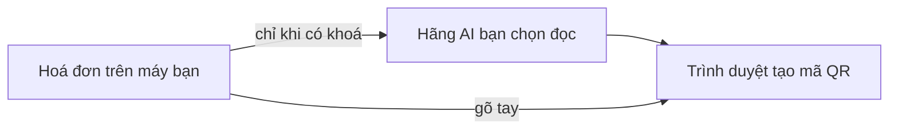

# Hoá đơn → mã QR chuyển khoản

**Tóm tắt:** Thả ảnh hoặc PDF hoá đơn vào trang web, AI đọc số tài khoản bên bán và số tiền, ra mã VietQR.
App ngân hàng nào ở Việt Nam cũng quét được. Miễn phí, chạy trong trình duyệt, không cần cài.

👉 **Dùng ngay:** https://kinsamson0101.github.io/hoa-don-qr/

## Dùng thế nào

1. Mở trang, vào **Cài đặt**, chọn hãng AI và dán khoá của hãng đó. Danh sách model tự tải về từ hãng,
   tool chọn sẵn model mới và nhanh, bạn đổi tuỳ ý.
2. Đặt **mẫu nội dung chuyển khoản** theo chuẩn công ty, ví dụ `TT HD {so_hd} {ncc}`.
3. Kéo thả 1 hoặc nhiều hoá đơn vào. Mỗi hoá đơn ra 1 thẻ: ô đã điền sẵn + mã QR.
4. **So số tài khoản và số tiền với hoá đơn**, sửa nếu sai. Bấm **Tải ảnh QR** hoặc quét thẳng trên màn hình.

Không có khoá AI vẫn dùng được: bấm **+ Tạo mã không cần hoá đơn** rồi tự gõ.

| Hãng | Lấy khoá | Ghi chú |
|---|---|---|
| Google Gemini | [aistudio.google.com/apikey](https://aistudio.google.com/apikey) | Có gói miễn phí |
| Anthropic Claude | [platform.claude.com/settings/keys](https://platform.claude.com/settings/keys) | Trả phí theo lượt |
| OpenAI (ChatGPT) | [platform.openai.com/api-keys](https://platform.openai.com/api-keys) | Trả phí theo lượt |
| DeepSeek | [platform.deepseek.com/api_keys](https://platform.deepseek.com/api_keys) | Rẻ; PDF được đổi sang ảnh trước khi gửi |
| OpenRouter | [openrouter.ai/settings/keys](https://openrouter.ai/settings/keys) | 1 khoá dùng mọi hãng, có model miễn phí |

Model bận hoặc không đọc được file thì tool tự thử thêm tối đa 2 model khác cùng hãng.

| Ô trong mẫu nội dung | Lấy từ hoá đơn |
|---|---|
| `{so_hd}` | Số hoá đơn |
| `{ncc}` | Tên ngắn bên bán |
| `{mst}` | Mã số thuế bên bán |
| `{ngay}` | Ngày hoá đơn, dạng ddmmyy |

## Dữ liệu đi đâu



- Trang không có máy chủ, không lưu hoá đơn. Khoá chỉ nằm trên trình duyệt của bạn, mỗi hãng một khoá.
- Khoá **miễn phí**: Google được dùng dữ liệu gửi lên để cải thiện sản phẩm. Hoá đơn mật thì bật thanh toán
  cho khoá, hoặc gõ tay.
- Gói miễn phí giới hạn số lần đọc mỗi phút. Thả nhiều file thì trang đọc lần lượt; báo hết lượt thì đợi 1 phút
  rồi bấm **Đọc lại**.

## Giới hạn

- AI có thể đọc sai số. Luôn kiểm trước khi chuyển tiền.
- Nội dung chuyển khoản tự bỏ dấu, tối đa 50 ký tự (ngân hàng không nhận dấu).
- Danh sách 76 ngân hàng lấy từ VietQR ngày 11/11/2026.

## Cho dev

```bash
npm install
npm test                    # 12 test: chuỗi VietQR, giải mã QR, chọn model mặc định (có 1 test gọi danh sách OpenRouter thật)
node tools/update-banks.js  # cập nhật danh sách ngân hàng
python samples/make_sample.py  # vẽ lại hoá đơn mẫu (dữ liệu giả)
```

Trang tĩnh, không build: `index.html`, `app.js`, `providers.js` (5 hãng AI, danh sách model lấy từ API của hãng), `vietqr.js` (tạo chuỗi VietQR theo chuẩn EMVCo của NAPAS),
`banks.js`, `vendor/qrcode.js`. Thư viện bên thứ ba: [THIRD-PARTY.md](THIRD-PARTY.md).

Giấy phép MIT. Làm bởi [kinsamson0101](https://github.com/kinsamson0101). Cần tool riêng cho việc lặp lại của
bạn? Nhắn Telegram [t.me/iamsamson](https://t.me/iamsamson).
